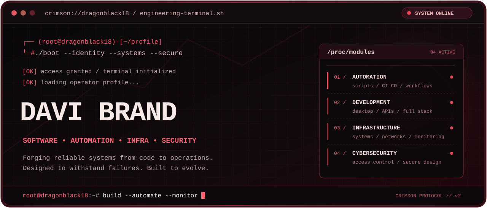
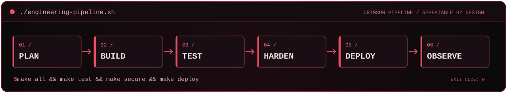

<!-- PROFILE README — CRIMSON TERMINAL EDITION
     Original visual assets are versioned locally in ./assets/.
     Animation: bespoke dark-fantasy eclipse scene, not footage from an anime.
-->

<div align="center">



<br />

<a href="https://github.com/DragonBlack18?tab=repositories"></a>
<a href="https://github.com/DragonBlack18/DeployCraft"></a>
<a href="https://github.com/DragonBlack18/vyrnode-releases"></a>

</div>

<div align="center">
  
  <sub>THE CRIMSON ECLIPSE · ARTWORK / LOOP / BUILT FOR THIS PROFILE</sub>
</div>

## `[ 01 ] root@dragonblack18:~# whoami`

```console
┌── (root@dragonblack18)-[~/profile]
└─# cat identity.env

NAME="Davi Brand"
HANDLE="@DragonBlack18"
FIELD="Software Development + IT Operations"
FOCUS="Automation | Infrastructure | Cybersecurity"
PHILOSOPHY="Build it. Test it. Secure it. Keep it running."
STATUS="Always building"
```

Sou desenvolvedor com atuação em **suporte e operações de TI**, interessado em resolver problemas reais através de código, automação e infraestrutura.

Trabalho com aplicações desktop, sistemas web, APIs e ferramentas operacionais. Gosto de soluções **locais, confiáveis, auditáveis e que possam evoluir sem perder estabilidade**. Segurança faz parte das decisões de arquitetura — não é algo para adicionar somente no final.

## `[ 02 ] systemctl --list-units | grep active`

```text
UNIT                           LOAD    ACTIVE     DESCRIPTION
automation.service             loaded  active     Scripts, workflows, CI/CD
software-engineering.service   loaded  active     Desktop, APIs, web systems
infrastructure.service         loaded  active     Windows, Linux, networking
secure-development.service     loaded  active     Auth, RBAC, integrity
monitoring.service             loaded  active     Availability, logs, telemetry

5 loaded units listed.
```

<details>
<summary><b>cat /etc/engineering/modules.conf</b> · mais sobre minhas áreas</summary>

| Módulo | Áreas de atuação e estudo |
| :-- | :-- |
| **SOFTWARE_ENGINEERING** | Backend, aplicações desktop, APIs, interfaces e persistência de dados. |
| **AUTOMATION** | PowerShell, Python, workflows, pipelines e execução reproduzível. |
| **INFRASTRUCTURE** | Serviços Windows/Linux, Docker, redes, implantação e monitoramento. |
| **SECURE_DEVELOPMENT** | Autenticação, autorização, proteção de segredos, menor privilégio e integridade. |

</details>

## `[ 03 ] ls /opt/toolchain`

**`/languages-and-scripting`**


**`/application-and-database`**


**`/infrastructure-and-delivery`**


## `[ 04 ] tree ~/projects -L 1`

```text
/home/davi/projects/
├── DeployCraft          # offline deployment engine
├── OmniForge-Studio     # visual automation & development
├── VYRNODE              # infrastructure monitoring
├── sistema-de-academia  # business management software
├── Atlas-IA             # local desktop assistant
└── 2iad                 # startup incubation platform
```

| `REPOSITORY` | `DESCRIPTION` | `ACCESS` |
| :-- | :-- | :-- |
| **[DeployCraft](https://github.com/DragonBlack18/DeployCraft)** | Motor de implantação **offline** para Windows. Go, catálogos JSON, integridade e CI. **Em validação de laboratório.** | `PUBLIC` |
| **[OmniForge Studio](https://github.com/DragonBlack18/OmniForge-Studio)** | Plataforma desktop **experimental** de workflows, edição de código e integração de projetos. | `PUBLIC` |
| **[VYRNODE](https://github.com/DragonBlack18/vyrnode-releases)** | Monitoramento ICMP com controle e visualização. Link para releases; o código-fonte é privado. | `RELEASES` |
| **[Vitality Gym](https://github.com/DragonBlack18/sistema-de-academia)** | Sistema de gestão com autenticação, permissões e módulos operacionais. | `PUBLIC` |
| **[Atlas AI](https://github.com/DragonBlack18/Atlas-IA)** | Assistente local de desktop para Windows, com comandos de voz e automação. | `PUBLIC` |
| **[2IAD](https://github.com/DragonBlack18/2iad)** | Plataforma de gestão para uma incubadora de startups. | `PUBLIC` |

## `[ 05 ] ./engineering-pipeline.sh --strict`

<div align="center">
  
</div>

Meu objetivo é tornar entregas previsíveis: **mudanças incrementais, testes verificáveis, logs úteis, preservação de dados e distribuição reproduzível**.

## `[ 06 ] cat /etc/security/secure-development.conf`

```ini
[security]
authentication    = enforce_where_required
authorization     = server_side_checks
privileges        = least_privilege
secrets           = never_commit
input_validation  = required
integrity         = verify_artifacts

[operations]
changes           = incremental
testing           = reproducible
logs              = actionable
data              = preserve_on_update
monitoring        = built_in
```

*Cybersecurity é uma área de estudo e aplicação prática nos meus projetos, especialmente em desenvolvimento seguro e proteção de sistemas.*

---

<div align="center">
  <p><code>root@dragonblack18:~# echo "FORGE. AUTOMATE. DEFEND. REPEAT."</code></p>
  <strong>FORGE. AUTOMATE. DEFEND. REPEAT.</strong>
  <p><a href="https://github.com/DragonBlack18">github.com/DragonBlack18</a> · <code>exit 0</code></p>
</div>
