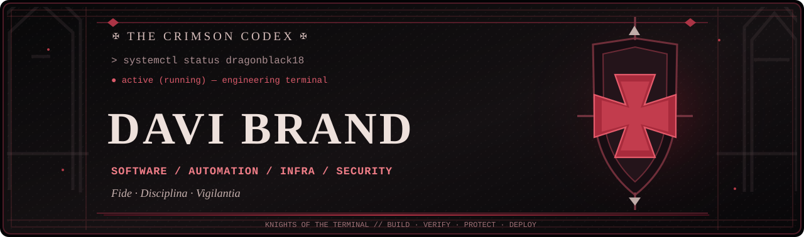
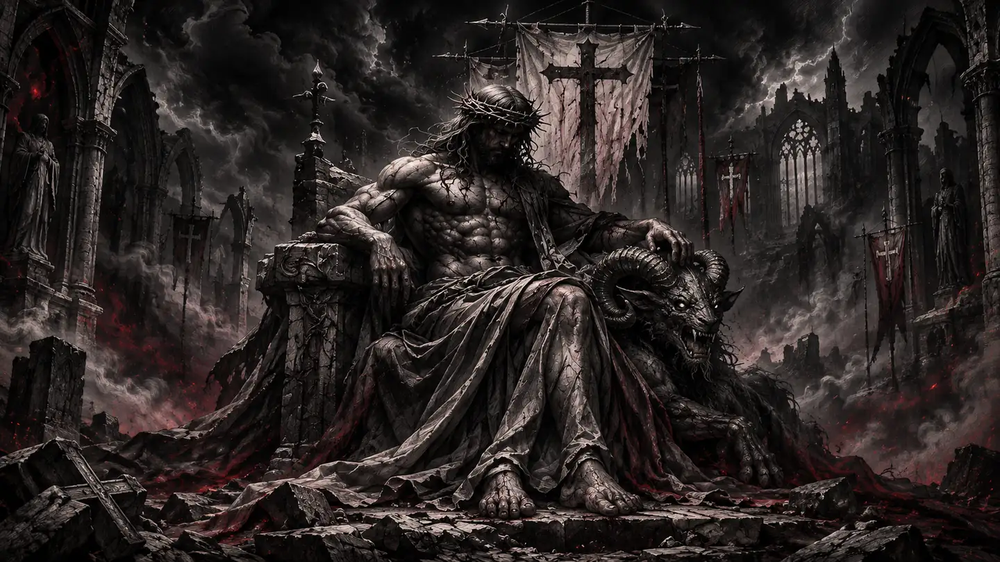
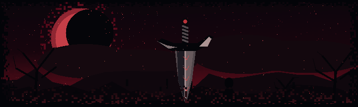
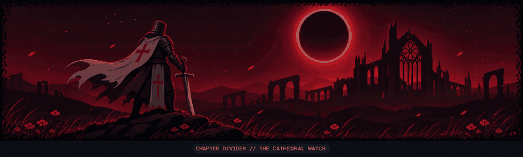
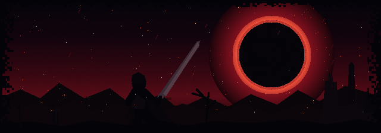
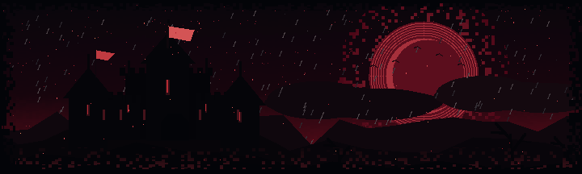
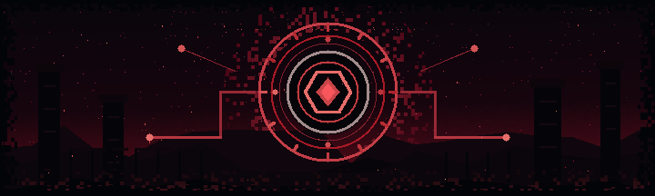

<!--
  DRAGONBLACK18 / TEMPLAR TERMINAL
  Identidade visual: fantasia gótica, pedra, aço e vermelho carmesim.
  README compatível com GitHub: HTML permitido, SVG e WebP locais; sem scripts.
  A arte de capa foi fornecida pelo proprietário do perfil.
-->

<div align="center">





<sub><code>✠  THE CRIMSON CODEX  ✠</code> · FIDE · DISCIPLINA · VIGILANTIA</sub>

<p>
  <a href="https://github.com/DragonBlack18?tab=repositories"></a>
  <a href="https://github.com/DragonBlack18/DeployCraft"></a>
  <a href="https://github.com/DragonBlack18/vyrnode-releases"></a>
</p>

</div>


## ✠ CAPÍTULO I — `whoami`

```console
┌── (davi@citadel)-[~/identity]
└─$ cat identity.conf

NAME           = Davi Brand
HANDLE         = DragonBlack18
DISCIPLINE     = Software Development & IT Operations
SPECIALTIES    = Automation | Infrastructure | Secure Engineering
ENVIRONMENT    = Windows / Linux
DIRECTIVE      = Build. Validate. Protect. Evolve.
```

Sou desenvolvedor com atuação em **suporte e operações de TI**, focado em transformar desafios reais em soluções de software, automação e infraestrutura.

Meu trabalho conecta **código, aplicações desktop, APIs, serviços, bancos de dados e monitoramento**. Priorizo projetos bem estruturados, funcionais, com proteção de dados, validações concretas e capacidade de evolução.

> **Fide · Disciplina · Vigilantia** — uma identidade visual de inspiração medieval, com princípios modernos de engenharia: disciplina técnica, confiabilidade e atenção à segurança.

## ✠ CAPÍTULO II — `systemctl list-units --type=service`

```text
UNIT                             STATE        DOMAIN
software-engineering.service     ACTIVE       Desktop / APIs / Web / Data
automation.service               ACTIVE       Python / PowerShell / CI/CD
infrastructure.service           ACTIVE       Windows / Linux / Networks
monitoring.service               ACTIVE       ICMP / Services / Logs
secure-development.service       ACTIVE       Auth / RBAC / Integrity

5 engineering modules loaded.
```

| Pilar | Aplicação prática |
| :--- | :--- |
| **I · Desenvolvimento de software** | Aplicações desktop e web, integrações, APIs, persistência e arquitetura modular. |
| **II · Automação** | Scripts, workflows, ferramentas de operação e pipelines de build e entrega. |
| **III · Infraestrutura** | Sistemas Windows/Linux, redes, Docker, serviços e ambientes de implantação. |
| **IV · Segurança** | Autenticação, permissões, menor privilégio, validação e proteção de credenciais. |

<div align="center">
  
  <sub><code>CHAPTER DIVIDER // THE IRON VOW</code></sub>
</div>

## ✠ CAPÍTULO III — `ls -la /opt/armory`

**`01 / LANGUAGES & AUTOMATION`**


**`02 / APPLICATIONS & DATA`**


**`03 / SYSTEMS & DELIVERY`**


## ✠ CAPÍTULO IV — `tree ~/projects -L 1`

```text
/home/davi/projects/
├── DeployCraft/           # deployments offline
├── OmniForge-Studio/      # visual engineering workspace
├── VYRNODE/               # network monitoring
├── sistema-de-academia/   # gestão com acesso controlado
├── Atlas-IA/              # assistente local de desktop
└── 2iad/                  # plataforma para incubadora
```

| Projeto | Engenharia aplicada | Acesso |
| :--- | :--- | :--- |
| **[DeployCraft](https://github.com/DragonBlack18/DeployCraft)** | Motor de implantação **offline** para Windows com Go, catálogo JSON, validação de integridade e CI. **Em laboratório.** | `PUBLIC` |
| **[OmniForge Studio](https://github.com/DragonBlack18/OmniForge-Studio)** | Workspace desktop **experimental** com automação visual, edição de código e ferramentas de engenharia. | `PUBLIC` |
| **[VYRNODE](https://github.com/DragonBlack18/vyrnode-releases)** | Monitoramento ICMP e disponibilidade de rede, com telas Control e Viewer. Repositório público de **releases**; código-fonte privado. | `RELEASES` |
| **[Vitality Gym](https://github.com/DragonBlack18/sistema-de-academia)** | Gestão de academia com autenticação, permissões e módulos de negócio. | `PUBLIC` |
| **[Atlas AI](https://github.com/DragonBlack18/Atlas-IA)** | Assistente local para Windows, com comandos de voz, automação e integração com IA. | `PUBLIC` |
| **[2IAD](https://github.com/DragonBlack18/2iad)** | Plataforma de gestão de incubadora de startups, editais e parceiros. | `PUBLIC` |

<div align="center">
  
  <sub><code>THE CATHEDRAL WATCH</code> · CAMERA DRIFT / WIND / FLOWERS / EMBERS / ECLIPSE</sub>
</div>

## ✠ CAPÍTULO V — `cat /etc/ordo/engineering-oath.conf`

```ini
[design]
architecture      = modular
complexity        = intentional
interfaces        = usable

[security]
authentication    = enforce_where_required
authorization     = validate_on_server
privileges        = least_privilege
secrets           = never_commit
integrity         = verify_artifacts

[operations]
automation        = reproducible
changes           = incremental_and_tested
logs              = actionable
monitoring        = built_in
user_data         = preserve_across_updates

[release]
tests             = required
evidence          = recorded
regressions       = investigated
```

A segurança é um campo que estudo e aplico nos meus projetos, especialmente em **desenvolvimento seguro, controle de acesso e proteção de sistemas**. Essas linhas representam princípios de trabalho — não uma certificação ou garantia de que todos os projetos já estejam homologados para produção.

## ✠ ARQUIVO DA CIDADELA — `ls ./animated-artworks/`

As animações antigas permanecem disponíveis. A nova cena <strong>The Cathedral Watch</strong> aparece em destaque acima; as demais ficam no arquivo expansível para manter o perfil organizado.

<details>
<summary><b>✠ Abrir o arquivo de wallpapers carmesins</b></summary>

<p align="center">
  
  <sub>THE CRIMSON ECLIPSE / SHADOW · EMBERS · PERSISTENCE</sub>
</p>

<p align="center">
  
  <sub>THE ASHEN CITADEL / RAIN · RUINS · NIGHTFALL</sub>
</p>

<p align="center">
  
  <sub>THE CRIMSON GATE / SYSTEMS · SIGNALS · RESOLVE</sub>
</p>

</details>


<div align="center">

<code>davi@citadel:~$ ./forge --build --validate --protect</code>

**✠ FORGE. AUTOMATE. DEFEND. REPEAT. ✠**

<sub>Entre pedra, aço e código. · GitHub: <a href="https://github.com/DragonBlack18">@DragonBlack18</a></sub>

</div>
